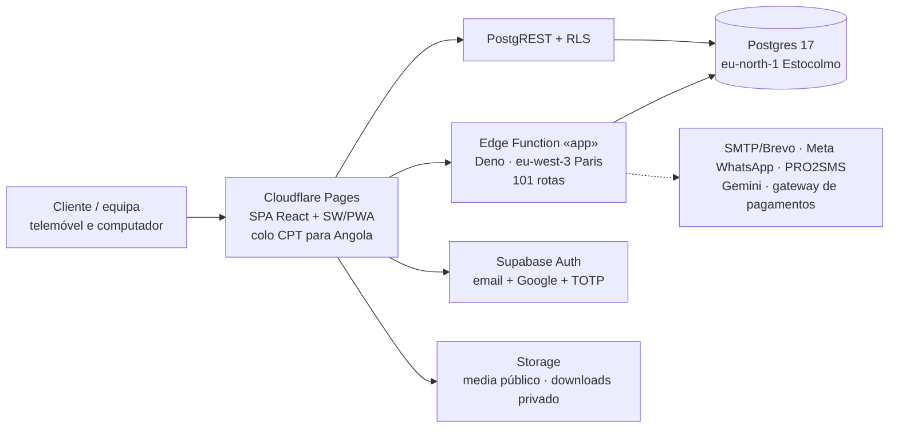

# Auditoria Premium 360° — Livraria Adventista

| | |
|---|---|
| **Data** | 2026-11-09 |
| **Versão auditada** | `main` em `7a5d6f0` (PR #56), a mesma que está publicada: deploy do Cloudflare Pages e do Supabase de 2026-11-08 19:03 UTC, ambos verdes |
| **Produção** | `https://livrariaadventista.ao` (Cloudflare Pages) · Supabase `bggqkjjqbjhbjsckzopj` (Postgres 17, `eu-north-1`, plano Free) |
| **Referências** | WCAG 2.2 AA · OWASP ASVS 5.0 (perfil nível 2 para comércio e autenticação) · Core Web Vitals (p75) · investigação de usabilidade da Baymard e da NN/g |
| **Regras cumpridas** | Nada foi alterado em produção. A base de dados foi só lida (`SELECT`, *advisors* e registos). Nenhum pagamento, nenhum deploy, nenhum dado criado. |
| **Evidências** | [`premium-360/evidencias/`](premium-360/evidencias/) — capturas e `resultados-testes.json` (184 medições visuais, 6 relatórios Lighthouse, axe-core, 20 verificações de ponta a ponta) |

> **Como ler este relatório.** Cada afirmação está marcada com o tipo de evidência:
> **[Facto]** confirmado por consulta, registo ou código · **[Reproduzido]** visto a acontecer num teste ·
> **[Suspeita]** precisa de investigação · **[Recomendação]** melhoria sem defeito associado ·
> **[Sem acesso]** não foi possível verificar nesta sessão.

---

## A. Diagnóstico geral

### Veredicto

**NÃO APROVADA PARA EXCELÊNCIA PREMIUM** — critério de bloqueio accionado: **corrupção do estado de encomendas**, confirmada em produção (achado [ENC-01](#enc-01)).

**Nota ponderada: 69/100** (intervalo provável 65–74), no topo da faixa «50–69: necessita de modernização significativa», a um ponto da «qualidade intermédia». **Cobertura: ~70% dos critérios com evidência directa. Confiança: média.** Os pormenores estão na [secção 15](#15-classificação-premium-fase-14).

### Em poucas palavras

A Livraria Adventista tem uma **base de engenharia acima do que é comum no mercado**: segurança da base de dados a sério (RLS em todas as tabelas, preços e totais calculados no servidor, livro-razão de pagamentos só de acrescentar, idempotência no checkout, webhook assinado), **1 573 testes automáticos** mais ~600 cenários de base de dados no CI, e um visual consistente que não parte em nenhuma das 8 larguras testadas (320 a 1440 px).

O que a separa de uma loja premium **não é o código, é a operação e o desempenho**:

1. **A loja ainda não fecha o ciclo comercial em produção.** Não há pagamento online (o Multicaixa Express foi desligado a 2026-11-08 e nenhum gateway está ligado), **nenhum email chegou a sair** (90 de 90 «ignorados» por falta de SMTP) e o registo por email está a ser recusado (3 × `429` nas últimas 24 h). A loja não tem telefone nem WhatsApp configurados.
2. **O painel deixa marcar uma encomenda como «Concluída» sem entrega nem pagamento**, por um caminho que salta a guarda do pagamento, a linha do tempo, o aviso ao cliente e o registo de segurança. Em produção, 4 das 6 encomendas estão nesse estado.
3. **No telemóvel a loja é lenta** (Lighthouse em laboratório: LCP 6,8–9,2 s; meta 2,5 s) e o primeiro ecrã da loja não mostra nenhum livro.
4. **SEO técnico com um erro de configuração**: todas as páginas servidas pela SPA (loja, categorias, sobre, FAQ…) dizem ao Google que são a página inicial (`canonical`).
5. **Conteúdo do catálogo incompleto**: 0 de 102 livros com ISBN, 99 sem número de páginas, e um aviso de stock baixo em 82% dos cartões.

### O que já está excelente (manter)

| Área | Porquê | Evidência |
|---|---|---|
| Integridade do checkout | O cliente só envia `variant_id` e quantidade; preço, promoções, portes e total são calculados no `place_order`; botão trancado durante o pedido; chave de idempotência; carrinho revalidado antes de encomendar | [Reproduzido] E2E: 1 pedido em 3 cliques, sem preços no corpo |
| Pagamentos | Livro-razão `order_payments` só de acrescentar, estado do pagamento derivado, permissão separada «Confirmar pagamentos», webhook HMAC em tempo constante, duplicados ignorados | [Facto] `docs/PAGAMENTOS.md`, gatilho `orders_0_pagamento`, 91 cenários PGlite no CI |
| Segurança da base | RLS em todas as tabelas de `public`; 0 avisos de nível ERROR nos *advisors*; `SECURITY DEFINER` com `search_path` vazio; buckets com tipos e tamanhos limitados (SVG recusado) | [Facto] *advisors* de 2026-11-09, `storage.buckets` |
| Qualidade de engenharia | Lint limpo; 188 ficheiros e 1 573 testes a passar em 60 s; build em 10,5 s; 0 vulnerabilidades no `npm audit`; scanner de segredos limpo em 1 050 ficheiros; CI com migrações do zero e cenários de base de dados | [Facto] corridas nesta sessão |
| Consistência visual | Tipografia (Fraunces + Inter), cartões, botões e espaçamentos iguais em todo o site; 0 transbordos horizontais e 1 `h1` por página em 184 combinações página × largura | [Reproduzido] Playwright, 23 páginas × 8 larguras |
| Formulários | Erros junto do campo, anunciados (`role="alert"`), foco levado ao primeiro erro, telefone angolano validado, morada província → município | [Reproduzido] E2E |
| Telemóvel | Barra inferior, barra de compra fixa na ficha, lista contínua com botão «Mostrar mais» acessível, memória da posição ao voltar, sessão que não cai sem rede | [Reproduzido] + código |
| Painel | 9 grupos, ~27 secções, paleta de comandos, permissões por área e cargos, registo de segurança, exportação CSV, acções em lote | [Facto] `lib/adminSections.js` |
| Emails (desenho) | Cabeçalho de marca, resumo, estados da encomenda, botão de acção, versão em texto, `List-Unsubscribe` com um clique | [Reproduzido] modelos renderizados ([imagem](premium-360/evidencias/email-encomenda-390.webp)) |

### As 10 acções com mais impacto, por ordem

| # | Acção | Achados | Quem |
|---|---|---|---|
| 1 | Tirar do painel o botão que muda o estado geral da encomenda (o estado passa a resultar só da entrega e do pagamento) e reconciliar as 6 encomendas de produção | [ENC-01](#enc-01), [OPS-02](#ops-02) | Código + dono |
| 2 | Ligar SMTP (Brevo) à loja **e** ao Supabase Auth, com SPF/DKIM/DMARC do `.ao`; activar «email automático» | [COM-01](#com-01) | Dono |
| 3 | Activar MFA nas 4 contas de administrador | [SEG-01](#seg-01) | Dono (10 min) |
| 4 | Escolher e ligar o gateway (Multicaixa Express/referências por EMIS GPO, AppyPay ou ProxyPay) ao webhook que já existe | [PAG-01](#pag-01) | Dono + código |
| 5 | Pôr telefone e WhatsApp da loja e das 3 lojas físicas | [COM-02](#com-02) | Dono |
| 6 | Backups diários (plano Pro) e um teste de restauro | [OPS-01](#ops-01) | Dono |
| 7 | `canonical`, `description` e `og:` por página; dados estruturados de produto | [SEO-01](#seo-01), [SEO-02](#seo-02) | Código |
| 8 | Desempenho no telemóvel: carregar o carrinho/checkout só ao abrir, imagens responsivas em WebP/AVIF, herói leve, pré-carregar a imagem principal | [PERF-01](#perf-01), [PERF-02](#perf-02) | Código |
| 9 | Primeiro ecrã da loja com livros; checkout utilizável em 360×640 com teclado aberto | [MOB-01](#mob-01), [MOB-02](#mob-02) | Código |
| 10 | Completar o catálogo (ISBN, páginas, ano, stock real) e corrigir o slide «Colportagem» | [CAT-02](#cat-02), [CAT-03](#cat-03), [CAT-04](#cat-04) | Equipa |

---

## 1. Inventário técnico e funcional (Fase 1)

### 1.1 Arquitectura



| Camada | Tecnologia (versão) | Notas |
|---|---|---|
| Frontend | React 18.3, React Router 7, Vite 7.3, Tailwind 4, Radix/shadcn, Framer Motion 11, Leaflet, Recharts | SPA; páginas em `lazy()`; blocos fixos `vendor-react`, `vendor-supabase`, `vendor-motion` |
| Backend | Supabase: Postgres 17, PostgREST, Auth, Storage, Realtime; Edge Function `app` (Deno 2, 5 646 linhas no `index.ts`, 27 módulos) | `verify_jwt = false`; autenticação feita na função |
| Dados | 116 migrações (22 016 linhas SQL), todas aplicadas em produção | [Facto] `list_migrations` = ficheiros do repositório |
| Infra | Cloudflare Pages (`_headers` com CSP, HSTS, `X-Frame-Options`), GitHub Actions (CI, deploy, backup semanal) | Firebase só para o Google Workspace do painel |
| Design system | Tokens Tailwind + componentes shadcn (57 em `components/ui`), Fraunces (títulos) + Inter (texto), cor de marca configurável | `docs/SPEC-COMPONENTES.md` |
| Código | ~67 100 linhas de JS/JSX sem testes (das quais ~7 700 em páginas e ~12 800 em `lib`) | 156 ficheiros de teste no site + 27 na função |

### 1.2 Produção em números (2026-11-09, só leitura)

| Indicador | Valor |
|---|---|
| Produtos | 102 activos: 101 livros + 1 Bíblia; 0 com variantes, 0 digitais, 0 com vídeo, 0 com amostra |
| Encomendas | 6 (todas com conta; 1 paga) — aparentam ser de teste ([OPS-02](#ops-02)) |
| Contas | 7 (4 administradores, 3 clientes); 5 com Google; **0 com MFA** |
| Pagamentos registados | 1; eventos de gateway: 0 |
| Emails | 90 tentativas, **90 `skipped`** («Servidor SMTP não configurado»), a última hoje às 06:10 UTC |
| WhatsApp | 1 tentativa, falhada (token inválido); integração desligada a 2026-11-08 |
| Tráfego da API (24 h) | ~81% de Angola (646 de 801 pedidos), servido pelo Cloudflare da Cidade do Cabo (`CPT`) e pela Edge Function em Paris; 0 respostas 5xx |

### 1.3 Inventário funcional e estado

Legenda: ✅ operacional · 🟡 parcialmente operacional · 🔴 com defeito · ⚪ não implementado/não configurado · ❔ não verificado · — não aplicável.

| Módulo | Estado | Evidência / nota |
|---|---|---|
| Página inicial (herói, destaques, prateleiras por tema, «Mais para si») | ✅ | [Reproduzido] 8 larguras |
| Loja `/shop`: filtros, 8 ordenações, grelha/lista, agrupar por tipo, lista contínua (telemóvel) e páginas (computador) | ✅ | [Reproduzido] |
| Categorias `/shop/:categoria` e colecções `/colecoes/:slug` | ✅ | [Reproduzido] |
| Ficha de produto (variantes, edição digital, vídeo, amostra) | 🟡 | Funciona com livros simples; variantes/digital/vídeo/amostra existem no código mas **sem dados em produção** [Sem acesso a dados reais] |
| Pesquisa no cabeçalho | 🟡 | Tolera acentos, não tolera erros ortográficos ([CAT-01](#cat-01)) |
| Carrinho persistente com revalidação | ✅ | [Reproduzido] `localStorage` `e-commerce-cart` |
| Checkout (entrega, levantamento, digital, convidado, idempotência) | 🟡 | Mensagem de rede crua e ergonomia em ecrãs pequenos ([CHK-01](#chk-01), [MOB-02](#mob-02)) |
| Pagamento na entrega, no balcão, por transferência (confirmação manual) | ✅ | [Facto] 3 métodos activos |
| Multicaixa Express, referências, AppyPay, gateway | ⚪ | [Facto] MCX `enabled=false` desde 2026-11-08 03:56; 0 eventos de gateway ([PAG-01](#pag-01)) |
| Estado da encomenda no painel | 🔴 | [Facto] 4/6 encomendas incoerentes ([ENC-01](#enc-01)) |
| Página de sucesso, recibo HTML, partilha | 🟡 | Recibo não fiscal ([FIS-01](#fis-01)) |
| Rastreio `/track` + trajecto GPS | ✅ / ❔ | Mensagens certas [Reproduzido]; GPS não testado em campo |
| Conta: email/Google, MFA, encomendas, cancelar, biblioteca, exportar/apagar | 🟡 | Registo por email recusado em produção ([COM-01](#com-01)) |
| Emails transaccionais | 🔴 | [Facto] 0 enviados |
| WhatsApp Business / SMS PRO2SMS / push | ⚪ / ❔ / ❔ | WhatsApp desligado; SMS sem envios; 2 subscrições push |
| Assistente (chat) | ❔ | Simulado nesta sessão |
| Comunidade, materiais, novidades, sugestões, colportagem | ✅ | [Reproduzido] (pouco uso real) |
| Painel (catálogo, editora, vendas, relatórios, clientes, pessoal, igreja, sistema) | ✅ / 🔴 | Por código, registos e passagens anteriores; **não aberto com sessão nesta passagem** ([secção 7](#7-administração-e-crud-fase-6)) |
| CI/CD, backups | ✅ / 🟡 | CI e deploys verdes; backup semanal correu 1 vez, restauro nunca testado ([OPS-01](#ops-01)) |
| Observabilidade | 🟡 | Registos e `X-Request-Id`; sem alertas nem RUM ([OBS-01](#obs-01)) |

---

## 2. Método e evidências

| O quê | Como | Resultado |
|---|---|---|
| Gates locais | `npm ci`, `eslint`, `vitest run`, `vite build`, `npm audit`, `scripts/verificar-segredos.mjs` | Tudo verde: 1 573/1 573 testes, 0 vulnerabilidades, 0 segredos |
| Produção (só leitura) | Conector do Supabase: *advisors* de segurança e desempenho, `list_migrations`, `SELECT` agregados (sem ler segredos nem dados pessoais desnecessários), registos das últimas 24 h | Ver secções 6, 8 e 9 |
| GitHub | Execuções do Actions | CI, deploys e backup verdes |
| Navegador | Build de produção servido localmente **com os cabeçalhos do `_headers` (CSP incluída)**; API do Supabase simulada com os **dados públicos reais** (102 livros, colecções, slides, lojas, métodos de pagamento, definições); Chromium via Playwright | 184 medições visuais, 20 verificações E2E, teclado |
| Acessibilidade | axe-core 4.10.3 com as regras WCAG 2.0/2.1/**2.2** A/AA e boas práticas, a 390 e 1280 px | Secção 10 |
| Desempenho | Lighthouse 12.6 (telemóvel com limitação simulada e computador) contra o mesmo build, com a API simulada à **latência mediana de produção** (Edge Function 500 ms, REST 220 ms); medição do bundle | Secção 8 |
| Emails | Modelos da Edge Function renderizados com Node (`--experimental-strip-types`) e fotografados a 390 e 700 px | Secção 12 |

**Limitações** [Sem acesso]: a rede desta sessão recusa `livrariaadventista.ao` e `*.supabase.co` (por isso não houve medição do site publicado nem dados de campo); não houve sessão de equipa no navegador; não houve dispositivos reais (iOS Safari, Android de gama baixa) nem leitores de ecrã (NVDA/VoiceOver/TalkBack); configuração do Cloudflare (WAF, DNS, Email Routing) e do Supabase Auth (política de palavras-passe, SMTP) não legível daqui.

---

## 3. Auditoria visual (Fase 2)

**Cobertura**: 23 rotas (início, loja, categoria, colecções, 3 fichas — normal, esgotada, sem descrição —, sobre, lojas, contacto, FAQ, envios, privacidade, rastreio, entrar, sugestões, comunidade, materiais, novidades, 404, slide «Colportagem», pesquisa vazia) × 8 larguras (320, 360, 390, 414, 768, 1024, 1280, 1440).

| Verificação | Resultado |
|---|---|
| Transbordo horizontal | **0** em 184 combinações [Reproduzido] |
| Um `h1` por página | 184/184 |
| Imagens partidas / sem `alt` | 0 / 0 |
| Títulos de página | Únicos e descritivos (ex.: «Nisto Cremos - As 28 Crenças… — Livraria Adventista») |
| Erros na consola | Só na comunidade, do Realtime que a simulação não serve (artefacto do teste) |

**Pontos fortes**: a ficha de produto no computador ([imagem](premium-360/evidencias/produto-1024.webp)) e o ecrã de entrada ([imagem](premium-360/evidencias/entrar-390.webp)) estão ao nível das referências: hierarquia clara, tipografia serifada nos títulos, preço em destaque, entrega estimada por região, informação de pagamento e levantamento.

**O que afasta do premium** (detalhe na matriz):

- **Carrosséis decorativos em páginas de catálogo e de serviço** — a loja abre com um carrossel de 7 imagens e o rastreio com outro; empurram os livros para baixo e pesam no LCP ([VIS-01](#vis-01)).
- **Alarme de stock em 82% dos cartões** («Restam N» a laranja) e «Restam 1» em 13 produtos, quando o certo é «Resta 1» ([CAT-04](#cat-04), [VIS-02](#vis-02)).
- **Capas a 340×510 px**: nítidas na grelha, mas desfocadas na ficha em ecrãs de densidade 2–3× ([PERF-02](#perf-02)).
- **Pormenores**: botão flutuante por cima da lista de lojas no checkout; coração de «favoritos» desalinhado a 1024 px; código interno «LIV-063» como etiqueta nos destaques; dinheiro em dois formatos (site «Kz 17 940,00», emails «9.000,00 Kz») ([VIS-03](#vis-03), [VIS-04](#vis-04)).

---

## 4. Experiência mobile (Fase 3)

| Critério | Estado | Nota |
|---|---|---|
| Cabeçalho e menu | ✅ | Barra inferior (Início, Categorias, Comunidade, Carrinho, Conta) + menu; pesquisa no topo |
| Pesquisa acessível | ✅ | Ícone no topo de todas as páginas |
| Grelha e cartões | ✅ | 2 colunas, botão «Comprar» de 44 px, favoritos |
| **Carregamento progressivo** | ✅ | Lotes de 24 com `IntersectionObserver` (600 px de antecedência), barra «X de Y livros» com `aria-live`, botão «Mostrar mais livros» como alternativa, fim de lista explícito, posição reposta ao voltar; no computador, páginas numeradas. Sem duplicados (lista ordenada em memória e cortada) [Facto] `useInfiniteList`, `CatalogInfiniteTail` |
| Rodapé | 🟡 | Rodapé curto com envios, pagamentos, Rastrear/Lojas/Contactos/Devoluções e privacidade; nas páginas com lista contínua só aparece quando a lista acaba ([MOB-03](#mob-03)) |
| Carrinho e checkout | 🟡 | Bom fluxo; **ecrãs pequenos e teclado** ([MOB-02](#mob-02)) |
| Primeiro ecrã | 🔴 | Loja sem nenhum livro visível a 360×800 ([MOB-01](#mob-01), [imagem](premium-360/evidencias/loja-360-primeiro-ecra.webp)) |
| Toque | ✅ | 1–2 alvos abaixo de 24 px por página (ex.: mostrar palavra-passe) |
| Desempenho percebido | 🔴 | LCP em laboratório 6,8–9,2 s ([PERF-01](#perf-01)) |
| Comprimento | 🟡 | Início ~15 ecrãs e ficha de produto ~15 ecrãs a 390 px (feed contínuo) |

---

## 5. Catálogo (Fase 4)

| Critério | Estado | Evidência |
|---|---|---|
| Tipos de produto (livros, Bíblias, material de estudo, artigos, vestuário…) | 🟡 | O modelo suporta tipos, variantes (tamanho/cor/edição), digitais, vídeo e amostras; em produção há **101 livros e 1 Bíblia** [Facto] |
| Categorias | 🟡 | 7 «géneros»; **«Catálogo Geral» junta 29 títulos (28%)** e não é um género ([CAT-02](#cat-02)) |
| Pesquisa e sugestões | 🟡 | «nisto cre» → 2 sugestões; «crencas» → 1; **«elen white» → 0** [Reproduzido] |
| Filtros combinados e ordenação | ✅ | Disponibilidade, destaque, colecção, género, preço; 8 ordenações com o preço que o cliente paga e esgotados no fim |
| Relacionados e recomendações | ✅ | «Quem leu este, procurou também» (colecção > autor > género > preço) |
| Promoções e campanhas | ✅ / ❔ | Janela de datas validada no servidor; **0 promoções activas** |
| Variantes, galerias | ❔ | Suportadas; 0 produtos com variantes; uma imagem por produto |
| Stock | 🟡 | 5 esgotados, 78 com 1–4 unidades, 84 com aviso de stock baixo: **parece provisório** ([CAT-04](#cat-04)) |
| Informação do produto | 🟡 | 100/102 com descrição (melhorou desde 2026-11-01, quando eram 2/102); **0/102 com ISBN, 3/102 com páginas**, 2 sem autor |
| Avaliações | ⚪ | Funcionalidade pronta, 0 avaliações |
| Inactivos e esgotados | ✅ | Ficha de esgotado com estado claro; ocultos fora da loja |
| Merchandising | 🔴 | Slide «Colportagem» → `/shop?category=Colportagem` → **0 resultados** ([CAT-03](#cat-03)) |

---

## 6. Carrinho, checkout e pagamentos (Fase 5)

### 6.1 Percurso Descoberta → Pós-venda

| Etapa | Estado | Nota |
|---|---|---|
| Descoberta | 🟡 | Pesquisa sem tolerância a erros; slide para lista vazia |
| Produto | ✅ | Preço, stock, entrega estimada, métodos de pagamento visíveis |
| Carrinho | ✅ | Persistente, quantidades, remover, portes grátis com barra de progresso, revalidação de preço e stock ao abrir e antes de encomendar |
| Identificação | ✅ | Compra sem conta (entrega e levantamento); conta obrigatória só para edição digital |
| Entrega | ✅ | Domicílio (província → município → localidade, GPS opcional), expresso, levantamento em 3 lojas |
| Pagamento | 🔴 | **Só métodos offline** ([PAG-01](#pag-01)) |
| Confirmação | 🟡 | Página de sucesso com número; **sem email** ([COM-01](#com-01)) |
| Pós-venda | 🟡 | Rastreio, cancelamento pelo cliente, reembolsos no livro-razão; estado da encomenda corrompível ([ENC-01](#enc-01)) |

### 6.2 Controlos (pedido explicitamente na Fase 5)

| Controlo | Estado | Evidência |
|---|---|---|
| Adicionar, remover, quantidades, persistência | ✅ | [Reproduzido] E2E |
| Indisponíveis | ✅ | Stock revisto no servidor (`for update`), mensagem «Stock insuficiente» mostrada [Reproduzido] |
| Preço completo e descontos | ✅ | Portes, grátis acima de 20 000 Kz, promoções com janela |
| Cupões | ⚪ | Não há cupões (decisão de negócio; o painel tem promoções por produto) |
| Validação dos dados | ✅ | Inline, com foco no primeiro erro [Reproduzido] |
| **Compras duplicadas** | ✅ | 3 cliques → 1 pedido; chave de idempotência; índice único no servidor [Reproduzido] |
| **Manipulação de preços** | ✅ | Corpo do pedido só com `variant_id` e `quantity` [Reproduzido] |
| Confirmação segura do pagamento | ✅ (desenho) / ⚪ (operação) | Só gateway assinado ou funcionário com permissão; nenhum gateway ligado |
| Recibo/factura | 🟡 | «Nota de encomenda» antes de pagar, «Recibo» depois; **não é factura certificada** ([FIS-01](#fis-01)) |
| Reembolsos e cancelamentos | ✅ | Reembolso limitado ao pago; cancelamento pelo cliente antes da preparação |
| Reconciliação pagamento ↔ encomenda ↔ stock | 🔴 | Estado geral desligado da entrega e do pagamento ([ENC-01](#enc-01)) |

### 6.3 Contexto angolano

- **Multicaixa Express**: desligado em produção a 2026-11-08 03:56 UTC (registo de segurança: `enabled: true → false` e o link de demonstração `pay.kursinha.com` apagado). É o método de pagamento móvel dominante em Angola; sem ele, quem quer pagar já tem de ir ao balcão, pagar à porta ou fazer uma transferência e esperar pela confirmação manual.
- **Referências de pagamento (EMIS) e AppyPay**: não há integração. O webhook genérico (`POST /webhooks/pagamentos`, HMAC-SHA256, idempotente por `transaction_id`, registo em `payment_gateway_events`) está pronto para receber um adaptador.
- **Testes de pagamento**: não houve nenhum (por regra desta auditoria e porque não há sandbox configurado). As regras do servidor estão cobertas por 91 cenários PGlite que correm em cada PR.

---

## 7. Administração e CRUD (Fase 6)

**Âmbito**: 9 grupos (Catálogo, Editora, Vendas, Relatórios, Clientes, Pessoal, Igreja, Sistema e Início), ~27 secções com sub-vistas, paleta de comandos, disposição em separadores ou barra lateral. [Facto] `app/web/src/lib/adminSections.js`. O painel **não foi aberto com sessão nesta passagem** (sem conta de teste); a avaliação usa o código, os registos de produção e as passagens anteriores (9.12 e 9.16 do `docs/AUDITORIA.md`, que abriram os separadores com sessão numa réplica local).

| Padrão CRUD | Produtos | Encomendas | Clientes | Pagamentos | Notas |
|---|---|---|---|---|---|
| Listagem, pesquisa, filtros | ✅ | ✅ | ✅ | ✅ | Indicadores clicáveis (sem capa, sem descrição…) |
| Ordenação / paginação | ✅ / ⚪ | ✅ / ⚪ | ✅ / ✅ | ✅ | Encomendas e produtos carregados por inteiro (decisão documentada até ~2 000 encomendas) |
| Criar, editar, ver detalhe | ✅ | ✅ | ✅ | ✅ | Formulário de livros com teste de montagem |
| Validações | ✅ | 🔴 | ✅ | ✅ | Estado geral sem validação ([ENC-01](#enc-01)) |
| Selecção múltipla e acções em lote | ✅ | ⚪ | — | — | Produtos: lote (promoção, visibilidade, exportar) |
| Exportação | ✅ | ✅ | ✅ | ✅ | CSV |
| Arquivo e recuperação | 🟡 | — | ✅ (suspender) | ✅ (anular) | Produtos **apagados de vez**; há «ocultar» ([ADM-01](#adm-01)) |
| Confirmação de destrutivas | 🟡 | 🟡 | ✅ | ✅ | `window.confirm()` nativo |
| Histórico e rastreabilidade | ✅ | 🟡 | ✅ | ✅ | Registo de segurança só de acrescentar; **mudanças de estado geral não ficam registadas** |

**Facilidade de uso sem formação**: boa — textos em linguagem simples, descrições em cada secção, avisos de configuração em falta. O maior risco é haver **dois conjuntos de botões de estado** na mesma encomenda («Estado da encomenda» e «Estado da entrega»), que levam a decisões contraditórias.

---

## 8. Desempenho e fluidez (Fase 7)

### 8.1 Lighthouse (laboratório)

Build de produção; API simulada à latência mediana de produção; telemóvel = limitação simulada do Lighthouse (4× CPU, rede lenta). **Não são dados de campo** (ver [OBS-01](#obs-01)).

| Página | Telemóvel: desempenho | LCP | TBT | CLS | Computador: desempenho | LCP | CLS |
|---|---|---|---|---|---|---|---|
| Início | **56** | **6,8 s** | 350 ms | 0 | 91 | 1,5 s | 0,003 |
| Loja | **54** | **9,2 s** | 390 ms | 0,067 | 75 | 1,9 s | **0,266** |
| Ficha de produto | **59** | **7,6 s** | 250 ms | 0 | 87 | 2,1 s | 0 |

Acessibilidade 96–100, SEO 100 e boas práticas 81–82. O SEO 100 não contradiz [SEO-01](#seo-01): no teste local a origem (`localhost`) é diferente da do `canonical`, e a regra do Lighthouse que o apanharia só se aplica na mesma origem — em produção, `/shop` deve perder pontos aí. A única falha de boas práticas é um aviso de CORS **da simulação** (a Edge Function de produção lista os cabeçalhos um a um).

**Metas Core Web Vitals (p75)**: LCP ≤ 2,5 s ✗ no telemóvel · INP ≤ 200 ms ❔ (TBT de 250–390 ms indica risco) · CLS ≤ 0,1 ✗ na loja em computador.

### 8.2 Porque é lento no telemóvel

| Causa | Medida | Achado |
|---|---|---|
| JavaScript | Página inicial no telemóvel: **67 ficheiros, 507 KB comprimidos**; arranque: `index` 92 KB + React 59 KB + Supabase 58 KB + Framer Motion 37 KB + CSS 34 KB; o carrinho/checkout (`ShoppingCart` 40 KB + `select` 26 KB + `angolaPhone` 19 KB) é carregado **mesmo com o carrinho fechado**; o Framer Motion soma 3,1 s de CPU no telemóvel simulado | [PERF-01](#perf-01) |
| Imagens | **1 691 KB** em 48 imagens na primeira visita; herói `slide-catalogo.webp` de 150 KB (1920 px) servido ao telemóvel; capas JPEG (o Lighthouse estima −595 KB com WebP/AVIF) | [PERF-02](#perf-02) |
| Cadeia de dependências | O LCP (herói) só é conhecido depois de o JS correr e de `hero_slides` responder; sem `preload` | [PERF-01](#perf-01) |
| API | Produção, 24 h, tempo no servidor: `/settings` p50 543 ms / p95 1 706 ms, `/integrations` p50 617 / p95 1 649 ms, `stock_books` p50 431 / p95 996 ms; caminho Angola → Cidade do Cabo → Paris → Estocolmo; **sem `Access-Control-Max-Age`** (pré-voos `OPTIONS` em cada pedido autenticado: 1 045 no REST e ~150 na função) | [PERF-03](#perf-03) |
| Sondagem | 2 501 `GET staff_notifications` em 24 h para 4 pessoas da equipa | [PERF-03](#perf-03) |
| Estabilidade | CLS 0,266 na loja em computador: o `main` desce quando chegam os dados (0,242) | [PERF-04](#perf-04) |

### 8.3 O que está bem

Divisão de código por página; `vendor-*` estáveis entre deploys; `/assets/*` com `immutable`; HTML e `sw.js` sem cache; service worker com rede primeiro para o HTML; cache curta do catálogo com junção de pedidos simultâneos; fontes com `preconnect`; Recharts e Leaflet fora da página inicial.

---

## 9. Segurança profissional (Fase 8) — perfil ASVS 5.0 nível 2

| Capítulo ASVS 5.0 | Estado | Evidência |
|---|---|---|
| V1 Codificação e sanitização | ✅ | DOMPurify com lista branca; `SafeLink` contra `javascript:`; CSP sem `unsafe-inline` em scripts |
| V2 Validação e lógica de negócio | 🟡 | Preços, stock, totais e pagamentos no servidor ✅; **estado geral da encomenda sem regra** ([ENC-01](#enc-01)) |
| V3 Segurança do frontend web | ✅ | CSP restrita ao projecto Supabase, `frame-ancestors 'self'`, `nosniff`, `Referrer-Policy`, `Permissions-Policy`; HSTS de 180 dias sem `includeSubDomains` ([SEG-03](#seg-03)) |
| V4 API | ✅ | Rotas com guarda (69–78 revistas uma a uma nas passagens 9.8–9.15; das 101 de hoje, uma amostra de 10 rotas recentes — SMS, colportores, rastreio ao vivo, gateway, exportação, versões — conferida nesta passagem, todas com guarda); limites partilhados com `429` e `Retry-After`; corpo limitado a 1 MB |
| V5 Ficheiros | ✅ | `media` só imagens (sem SVG), 10 MB; `downloads` privado, só PDF, links temporários |
| V6 Autenticação | 🔴 | **0 de 4 administradores com MFA** ([SEG-01](#seg-01)); protecção contra palavras-passe vazadas desligada; mínimo de palavra-passe do servidor por confirmar ([SEG-02](#seg-02)) |
| V7 Sessões | 🟡 | Sessões do Supabase (JWT de 1 h + renovação) guardadas em `localStorage` (risco residual mitigado pela CSP); fim de sessão noutros aparelhos disponível |
| V8 Autorização | ✅ | RLS em todas as tabelas; `has_permission` só com booleanos; MFA exigido no servidor para contas com factor; isolamento entre clientes testado em passagens anteriores |
| V11 Criptografia | ✅ | Webhook HMAC-SHA256 com comparação em tempo constante; códigos SMS guardados como HMAC |
| V13 Configuração | ✅ | Segredos fora da API (`private.site_secrets`, vazia; segredos da função); scanner no CI |
| V14 Protecção de dados | ✅ | Exportar e apagar conta (Lei n.º 22/11); `no-store` nas respostas com dados pessoais |
| V16 Registo e erros | 🟡 | Registo de segurança só de acrescentar; erros internos não saem para o browser; **mudanças do estado geral não ficam registadas**; sem alertas ([OBS-01](#obs-01)) |
| Dependências | ✅ | `npm audit`: 0 vulnerabilidades (produção e desenvolvimento) |
| Continuidade | 🔴 | Plano Free sem PITR; backup semanal (correu 1 vez); restauro nunca testado ([OPS-01](#ops-01)) |
| Cloudflare (WAF, regras, origem) | ❔ | Sem acesso nesta sessão; não há origem própria (Pages + Supabase geridos) |

**Supabase *advisors* (2026-11-09)**: 0 ERROR. WARN: protecção de palavras-passe vazadas desligada; 16 funções `SECURITY DEFINER` chamáveis por anónimos (leituras públicas da comunidade, materiais e directório — revistas como intencionais); 80 chamáveis por clientes com sessão (cada uma verifica a permissão por dentro, segundo as passagens anteriores). INFO: 12 tabelas com RLS e sem políticas (só service role, intencional); 103 índices ainda sem uso (normal com este tráfego).

**Testes destrutivos ou invasivos em produção: nenhum.**

---

## 10. Acessibilidade e inclusão (Fase 9)

axe-core 4.10.3, regras WCAG 2.0/2.1/2.2 A e AA + boas práticas, 10 páginas a 390 e 1280 px.

| Resultado | Detalhe |
|---|---|
| Violações **críticas** | **0** |
| Violações WCAG A | **0** |
| WCAG 2.2 **2.5.8 Target Size (AA)** — séria | Setas dos menus «Livros», «Coleções», «Ajuda» com 22×30 px em todas as páginas do computador; botão «Mostrar palavra-passe» com 16×16 px no `/login` ([A11Y-02](#a11y-02)) |
| WCAG **1.4.3 Contraste (AA)** — séria | Etiqueta de 10 px na página da colecção a 3,58:1 ([A11Y-03](#a11y-03)) |
| Boas práticas (moderadas) | `region` em quase todas as páginas, ordem dos títulos, `/login` sem `main`, `aside` dentro de outra região |
| Teclado | Foco sempre visível e nunca tapado (o cabeçalho reaparece com o foco); **sem «Saltar para o conteúdo»**; no telemóvel a barra fina e o cabeçalho repetem 4 controlos na ordem de tabulação ([A11Y-01](#a11y-01)) |
| Fluxos essenciais | Pesquisa, carrinho e checkout funcionam ao teclado; erros anunciados com `role="alert"`; lista contínua com botão alternativo |
| Movimento | `prefers-reduced-motion` respeitado nos testes; carrosséis com setas e pontos |
| Leitores de ecrã reais | ❔ Não testados |

Lighthouse: acessibilidade 96–100. **Não há incumprimentos graves nos fluxos essenciais**; os dois pontos WCAG 2.2 são correcções pequenas.

---

## 11. SEO, descoberta e conversão (Fase 10)

| Critério | Estado | Evidência |
|---|---|---|
| URLs legíveis | 🟡 | `/shop/Fé%20%26%20Doutrina` e `/colecoes/essenciais-fe` legíveis; produto por id (`/product/pb57b6i7pc144ei`), sem nome |
| Títulos | ✅ | Únicos por página |
| **Canonical** | 🔴 | **Todas as rotas servidas pela SPA declaram `https://livrariaadventista.ao/`** (loja, 7 categorias, sobre, FAQ, lojas, comunidade, materiais…). Só as páginas estáticas de produto e colecção (geradas no deploy) têm o seu [Reproduzido] ([SEO-01](#seo-01)) |
| Meta description / Open Graph | 🔴 | Duas `meta description` em cada página (a geral fica primeiro); `og:title`/`og:url` gerais nas rotas da SPA |
| Sitemap e robots | ✅ | 114 URLs (fixas + 102 livros + 4 colecções); `robots.txt` exclui painel, conta e checkout |
| Dados estruturados | ⚪ | **Nenhum JSON-LD** (Product/Book/Offer/BreadcrumbList/Organization/Store) [Facto] ([SEO-02](#seo-02)) |
| Hierarquia de títulos | 🟡 | Saltos de nível em 6 páginas |
| Pré-renderização | 🟡 | SPA; o Google renderiza JS, mas o conteúdo e os preços não estão no HTML inicial |
| 404 | ✅ | Página própria com `noindex` |
| Redireccionamentos | ✅ | `.com`, `www` e `pages.dev` → `.ao`; aliases em português (`/sobre`, `/contacto`…) |
| Transparência | 🟡 | Portes, prazos, métodos e lojas claros; **sem telefone/WhatsApp** ([COM-02](#com-02)); empresa sem nome legal no recibo |
| Funil e carrinhos abandonados | ⚪ | Sem medição de funil nem recuperação de carrinho (decisão por autorizar) |

---

## 12. Conta do cliente e pós-venda (Fase 11)

| Critério | Estado | Nota |
|---|---|---|
| Registo e autenticação | 🔴 | Google ✅; **email: 3 × `429` em `/auth/v1/signup` nas últimas 24 h, 0 sucessos** (limite do SMTP do Supabase) [Facto] |
| Recuperação de palavra-passe | 🔴 / ❔ | Depende do SMTP do Auth; pelo histórico (achado 27 da auditoria anterior) só chega à equipa do projecto |
| Dados pessoais, moradas, telefone (confirmação por SMS) | ✅ / ❔ | SMS pela PRO2SMS sem envios ainda |
| Histórico e estado das encomendas | ✅ / 🔴 | Estados em linguagem simples, barra de 4 passos; **mostra «Entregue» em encomendas não entregues** ([ENC-01](#enc-01)) |
| Recibos | 🟡 | Não fiscais ([FIS-01](#fis-01)) |
| Biblioteca digital | ✅ | Só abre com pagamento confirmado |
| Cancelamentos e devoluções | ✅ | Cancelamento antes da preparação; página de envios e devoluções |
| Suporte | ✅ / 🟡 | Centro de atendimento na conta; chat; **sem telefone/WhatsApp** |
| Emails transaccionais — conteúdo | ✅ | Desenho de qualidade ([imagem](premium-360/evidencias/email-encomenda-390.webp)): marca, resumo, artigos, estados, botão, rodapé, texto simples, legível a 390 px |
| Emails transaccionais — entrega | 🔴 | **0 enviados** ([COM-01](#com-01)) |
| Segurança dos dados | ✅ | Exportar e apagar conta; avisos de novo acesso |

---

## 13. Testes funcionais de ponta a ponta (Fase 12)

Build de produção, Chromium 390×844 (perfil telemóvel), API simulada com o catálogo real; respostas do `/checkout` controladas para cada cenário. **18 das 20 verificações do teste passaram**; o cenário 15 (teclado) foi um teste à parte.

| # | Cenário | Resultado |
|---|---|---|
| 1 | Visitante pesquisa «nisto cre» | ✅ 2 sugestões |
| 2 | Pesquisa sem acentos «crencas fundamentais» | ✅ 1 sugestão |
| 3 | Pesquisa com erro «elen white» | ❌ **0 sugestões** ([CAT-01](#cat-01)) |
| 4 | Junta 2 produtos, recarrega a página, carrinho mantém-se | ✅ |
| 5 | Total do carrinho | ✅ «Kz 39 620,00» |
| 6 | Confirmar com o formulário vazio | ✅ 3 erros junto dos campos, foco no primeiro |
| 7 | Stock insuficiente no servidor | ✅ mensagem do servidor mostrada; botão volta a ficar activo |
| 8 | **Rede cai ao confirmar** | ❌ **«Não foi possível finalizar a compra — Failed to fetch»** ([CHK-01](#chk-01), [imagem](premium-360/evidencias/checkout-erro-de-rede.webp)) |
| 9 | Servidor lento (6 s) e três cliques | ✅ botão bloqueado com indicador; **1 só pedido**, com chave de idempotência |
| 10 | Pedido sem preços | ✅ só `variant_id` + `quantity` |
| 11 | Sucesso | ✅ página de confirmação com `ENC-TESTE0001` |
| 12 | Rastreio de encomenda inexistente | ✅ «não encontrada» |
| 13 | `/admin` e `/profile` sem sessão | ✅ levam ao `/login` |
| 14 | Carrinho vazio | ✅ mensagem e caminho de volta |
| 15 | Checkout a 360×640 e com teclado (altura útil 380 px) | ❌ zona do formulário com **18 px** ([MOB-02](#mob-02), [imagem](premium-360/evidencias/checkout-360x640-teclado.webp)) — reproduzido em simulação |

**Não testados nesta sessão**: pagamento bem-sucedido e falhado por gateway (não há gateway), administrador a criar produto e a processar encomenda (sem sessão), cliente a consultar histórico com dados reais. As regras do servidor destes casos estão cobertas pelos cenários PGlite do CI (pagamentos 91, entregas 111, conta 35, digitais 59, edições 50, trajecto 39, versões 39, produção 96, SMS 44, segurança).

---

## 14. Comparação internacional (Fase 13)

| Referência | Princípio | Pertinente para a LA? | Onde está a LA | Não reproduzir |
|---|---|---|---|---|
| **Apple** | Clareza, hierarquia, fotografia de produto impecável, pouco por ecrã | Sim | Hierarquia e tipografia ✅; capas de 340 px e heróis escuros em carrossel ✗ | Heróis de ecrã inteiro e vídeo pesado — em redes angolanas custam dados e segundos |
| **Stripe** | Formulários precisos, estados de carregamento, mensagens de erro úteis, idempotência | Sim | Validação inline e idempotência ao nível Stripe ✅; erro de rede cru ✗; teclado em ecrã pequeno ✗ | Densidade de painéis técnicos para clientes |
| **Shopify** | Estado da encomenda derivado do pagamento e do envio, arquivar em vez de apagar, linha do tempo com autor, emails padrão, métodos locais | Muito | Livro-razão de pagamentos ✅; estado geral manual ✗; apagar produtos ✗; emails desligados ✗ | Dependência de *apps* pagas para o essencial |
| **Amazon** | Pesquisa tolerante, filtros facetados, recomendações, disponibilidade e entrega estimada, avaliações | Muito | Filtros, recomendações e entrega estimada ✅; pesquisa sem tolerância ✗; 0 avaliações; stock alarmista ✗ | Urgência artificial, densidade de anúncios |
| **Linear** | Consistência, rapidez percebida, atalhos | Sim (painel) | Paleta de comandos e consistência ✅; rapidez no telemóvel ✗ | Estética escura em tudo |
| **Vercel** | Estados claros, observabilidade | Sim (operação) | Painel com estados claros ✅; sem alertas nem RUM ✗ | Jargão técnico para clientes |

**Contexto angolano**: rede móvel intermitente e dados caros (páginas abaixo de 1 MB, imagens responsivas, funcionar com rede fraca — a sessão e o carrinho já aguentam); Android de gama baixa a 360×640/720 (teclado, rodapés fixos, CPU); **Multicaixa Express e referências como métodos dominantes**; WhatsApp como canal principal de atendimento; formato do kwanza; províncias com prazos diferentes.

---

## 15. Classificação premium (Fase 14)

| Domínio | Peso | Nota | Pontos | Cobertura | Confiança | Razão principal |
|---|---|---|---|---|---|---|
| Qualidade visual e design system | 15% | 82 | 12,3 | Alta (184 medições) | Alta | Consistente e sem quebras; carrosséis, capas de baixa resolução e alarme de stock |
| UX, navegação e acessibilidade | 15% | 78 | 11,7 | Alta | Alta | 0 críticas axe; 2 falhas WCAG 2.2; menu escondido no topo; pesquisa e erro de rede |
| Experiência mobile | 10% | 70 | 7,0 | Média (simulação, sem dispositivos reais) | Média | Boa navegação e lista contínua; primeiro ecrã sem produtos; checkout em ecrã pequeno |
| Catálogo, pesquisa e descoberta | 10% | 66 | 6,6 | Alta | Alta | Ferramentas boas; conteúdo incompleto e taxonomia fraca |
| Carrinho, checkout e pagamentos | 15% | 52 | 7,8 | Média (sem gateway nem pagamentos reais) | Média | Engenharia excelente; sem pagamento online, sem emails, estado corrompível |
| Administração e operações | 10% | 75 | 7,5 | Média (painel não aberto com sessão) | Média | Muito completo; estado geral sem regra, apagar sem arquivo |
| Desempenho | 10% | 50 | 5,0 | Média (laboratório, sem dados de campo) | Média | Telemóvel 54–59 no Lighthouse, LCP 6,8–9,2 s |
| Segurança e privacidade | 10% | 78 | 7,8 | Alta | Alta | Controlos fortes; sem MFA nos admins, backups fracos |
| SEO, observabilidade e testes | 5% | 60 | 3,0 | Alta | Alta | Testes fortes; `canonical` errado, sem JSON-LD, sem alertas |
| **Total** | **100%** | | **68,7 ≈ 69** | **~70%** | **Média** | |

**Interpretação**: 69 fica no topo de «50–69: necessita de modernização significativa». A palavra «modernização» engana aqui: o código **já é moderno**; o que falta é **completar a operação comercial** (pagamento online, emails, contactos), **desempenho no telemóvel**, **SEO técnico** e **conteúdo do catálogo**. Só a acção 1 do plano (estado das encomendas) levanta o bloqueio; as ondas 1 e 2 levam a nota estimada para a faixa 80–85.

**Critérios de bloqueio**

| Critério | Accionado? | Evidência |
|---|---|---|
| Vulnerabilidades críticas confirmadas | Não | *advisors* sem ERROR; nada encontrado |
| Pagamentos inconsistentes ou inseguros | **Parcial** | Livro-razão consistente; mas 5 encomendas «Concluídas» com 0 Kz recebidos e uma com «pago» na linha do tempo e 0 Kz no livro-razão |
| **Perda ou corrupção de encomendas** | **Sim** | [ENC-01](#enc-01): estado geral contraditório em 4 de 6 encomendas, por um caminho do painel |
| Autorização com exposição de dados | Não | RLS e rotas com guarda |
| Impossibilidade de concluir compras | Não (com reservas) | Compra concluída com pagamento offline; registo por email falha ([COM-01](#com-01)) |
| Incumprimentos graves de acessibilidade nos fluxos essenciais | Não | 0 críticos, 0 WCAG A |

**→ NÃO APROVADA PARA EXCELÊNCIA PREMIUM** até [ENC-01](#enc-01) estar corrigido e validado.

---

## 16. Matriz de auditoria (B)

### 16.1 Resumo

| ID | Gravidade | Módulo | Problema | Tipo |
|---|---|---|---|---|
| [ENC-01](#enc-01) | **P0** | Painel → Encomendas | «Concluída» sem entrega nem pagamento; 4/6 encomendas incoerentes | Facto + reproduzido nos registos |
| [COM-01](#com-01) | **P0** | Emails / Auth | Nenhum email sai; registo por email recusado (429) | Facto |
| [PAG-01](#pag-01) | P1 | Pagamentos | Sem pagamento online (MCX desligado, nenhum gateway) | Facto |
| [SEG-01](#seg-01) | P1 | Autenticação | 0 de 4 administradores com MFA | Facto |
| [OPS-01](#ops-01) | P1 | Continuidade | Backup semanal, sem PITR, restauro nunca testado | Facto |
| [COM-02](#com-02) | P1 | Contactos | Sem telefone nem WhatsApp na loja e nas 3 lojas | Facto |
| [PERF-01](#perf-01) | P1 | Desempenho | LCP no telemóvel 6,8–9,2 s; 507 KB de JS | Reproduzido (laboratório) |
| [SEO-01](#seo-01) | P1 | SEO | `canonical` da página inicial em todas as rotas da SPA | Reproduzido |
| [FIS-01](#fis-01) | P1 | Fiscal | Recibo não é factura; facturação electrónica AGT por validar | Suspeita (validação fiscal) |
| [MOB-01](#mob-01) | P2 | Loja (telemóvel) | Primeiro ecrã sem nenhum produto | Reproduzido |
| [MOB-02](#mob-02) | P2 | Checkout (telemóvel) | Rodapé fixo ocupa 37% em 360×640; 18 px de formulário com teclado | Reproduzido (simulação) |
| [NAV-01](#nav-01) | P2 | Cabeçalho (computador) | Menu principal escondido no topo das páginas com herói | Reproduzido |
| [CHK-01](#chk-01) | P2 | Checkout | Erro de rede: «Failed to fetch» | Reproduzido |
| [CAT-01](#cat-01) | P2 | Pesquisa | Sem tolerância a erros ortográficos | Reproduzido |
| [CAT-02](#cat-02) | P2 | Catálogo | 0 ISBN, 3/102 com páginas, «Catálogo Geral» com 28% | Facto |
| [CAT-03](#cat-03) | P2 | Slides | «Colportagem» leva a 0 resultados | Reproduzido |
| [CAT-04](#cat-04) | P2 | Stock | 82% dos cartões com «Restam N» | Facto (suspeita de dados provisórios) |
| [PERF-02](#perf-02) | P2 | Imagens | JPEG 340 px sem srcset; herói de 1920 px no telemóvel; 1 691 KB | Reproduzido |
| [PERF-03](#perf-03) | P2 | API | p95 de 1,7 s em `/settings`; pré-voos sem cache; sondagem | Facto (registos) |
| [PERF-04](#perf-04) | P2 | Loja (computador) | CLS 0,266 | Reproduzido (laboratório) |
| [A11Y-01](#a11y-01) | P2 | Teclado | Sem «Saltar para o conteúdo»; controlos repetidos | Reproduzido |
| [A11Y-02](#a11y-02) | P2 | WCAG 2.2 | Alvos de 22×30 e 16×16 px | Reproduzido |
| [SEO-02](#seo-02) | P2 | SEO | Sem dados estruturados | Facto |
| [ADM-01](#adm-01) | P2 | Painel | `window.confirm()` e produtos apagados de vez | Facto |
| [OBS-01](#obs-01) | P2 | Observabilidade | Sem alertas, RUM nem erros do frontend | Facto |
| [TST-01](#tst-01) | P2 | Qualidade | Sem testes de navegador no CI | Facto |
| [SEG-02](#seg-02) | P2 | Autenticação | Palavras-passe vazadas desligado; mínimo do servidor por confirmar | Facto + suspeita |
| [VIS-01](#vis-01) | P2 | Visual | Carrosséis decorativos na loja e no rastreio | Reproduzido |
| [VIS-02](#vis-02) | P3 | Texto | «Restam 1»; código interno como etiqueta | Reproduzido |
| [VIS-03](#vis-03) | P3 | Visual | Botão flutuante sobre o checkout; favoritos desalinhado a 1024 px | Reproduzido |
| [VIS-04](#vis-04) | P3 | Visual | Dinheiro em dois formatos (site e emails) | Reproduzido |
| [A11Y-03](#a11y-03) | P3 | Contraste e estrutura | 3,58:1; ordem de títulos; `/login` sem `main` | Reproduzido |
| [SEG-03](#seg-03) | P3 | Cabeçalhos | HSTS sem `includeSubDomains`/`preload` | Facto |
| [PERF-05](#perf-05) | P3 | Catálogo | Catálogo inteiro com `select *` em cada carregamento | Facto |
| [MOB-03](#mob-03) | P3 | Telemóvel | Ficha e início com ~15 ecrãs; rodapé só no fim | Reproduzido |
| [OPS-02](#ops-02) | P3 | Dados | Encomendas e contas de teste em produção | Facto |
| [MIG-01](#mig-01) | P3 | Migrações | Versões com hora inválida (`…240000`, `…250000`) | Facto |
| [ADM-02](#adm-02) | P3 | Painel | Listas carregadas por inteiro | Facto |

### 16.2 Fichas

#### ENC-01
**P0 · Painel → Encomendas · Facto + reproduzido nos registos**
- **Problema**: os botões «Estado da encomenda» fazem `PATCH` directo a `orders.status` (`AdminPage.jsx:393` e `1309–1314`). Marcar «Concluída» assim **salta** a guarda «entregar com dinheiro por receber» (que só existe no caminho da entrega, com o diálogo `DeliveredPaymentDialog` e o `409` do servidor), **não escreve** na linha do tempo, **não avisa** o cliente e **não fica** no registo de segurança (`private.audit_orders` só regista o estado quando envolve cancelamento). O gatilho `order_status_follows_progress` só recalcula o estado quando muda a entrega.
- **Evidência**: produção — 4 encomendas com `status = delivered` e `delivery_status` `received`/`out_for_delivery`, 5 com `payment_status = pending` e 0 Kz recebidos; registos — 5 `PATCH /rest/v1/orders` por uma sessão `authenticated` entre 17:53:47 e 17:54:34 UTC de 2026-11-08, com os mesmos minutos do `updated` das encomendas. Uma encomenda de 245 000 Kz tem «pago» na linha do tempo e 0 Kz no livro-razão (anterior à migração dos pagamentos). O cliente vê «Entregue» (`lib/customerOrders.js:82`) e deixa de poder cancelar.
- **Impacto**: cliente (informação falsa), vendas e finanças (relatórios), operação (encomendas por entregar dadas como concluídas).
- **Causa**: dois estados editáveis para a mesma realidade; o papel `authenticated` pode actualizar `status` (ver `docs/PAGAMENTOS.md` §2).
- **Recomendação**: (1) tirar do painel os botões do estado geral, excepto «Cancelar»; (2) na base, revogar `UPDATE (status)` a `authenticated` ou recusar num gatilho qualquer `status` que não resulte da entrega/pagamento; (3) registar cada mudança de estado com autor; (4) reconciliar as 6 encomendas (ver [OPS-02](#ops-02)).
- **Validação**: cenário PGlite «gestor tenta pôr `status = delivered` com entrega `received` → recusado»; teste de componente sem os botões; consulta em produção `select count(*) from orders where status='delivered' and delivery_status<>'delivered'` = 0.

#### COM-01
**P0 · Emails e Auth · Facto**
- **Problema**: a loja não envia emails (fornecedor `smtp` sem servidor, sem chave Brevo/SendGrid/Cloudflare, `order_email_enabled = false`) e o Supabase Auth usa o SMTP incluído, que só entrega à equipa do projecto e com limite horário.
- **Evidência**: `notification_logs` — 90 de 90 `skipped` «Servidor SMTP não configurado», de 2026-11-02 até hoje 06:10 UTC; registos — 3 × `POST /auth/v1/signup` → `429` e 0 registos bem-sucedidos nas últimas 24 h; registo de segurança — links de acesso gerados no painel «o email não saiu».
- **Impacto**: cliente (sem confirmação de encomenda, sem recuperar palavra-passe, sem conseguir registar-se por email), vendas, confiança.
- **Causa**: configuração em falta (já identificada nos achados 27, 105–107 da auditoria anterior).
- **Recomendação**: Brevo (ou outro) com o domínio `.ao` verificado (SPF, DKIM, DMARC), o mesmo SMTP no Supabase Auth, `bash scripts/configurar-auth.sh` (modelos em português), ligar «email automático» e o Email Routing do `contacto@`.
- **Validação**: email de teste a Gmail e Outlook com SPF/DKIM/DMARC «pass»; registo e recuperação com uma conta externa à equipa; `notification_logs` com `sent`.

#### PAG-01
**P1 · Pagamentos · Facto**
- **Problema**: não há forma de pagar online. Activos: pagamento na entrega, no balcão e transferência com confirmação manual.
- **Evidência**: `payment_methods` — Multicaixa Express e Unitel Money `enabled = false`, nenhum `gateway_provider`; registo de segurança — MCX desligado a 2026-11-08 03:56 UTC e link de demonstração apagado; `payment_gateway_events` = 0.
- **Impacto**: vendas (abandono de quem quer pagar já), operação (conferência manual de extractos), atraso na preparação.
- **Causa**: gateway por escolher/contratar (`docs/PAGAMENTOS.md` §9).
- **Recomendação**: contratar um gateway com Multicaixa Express e referências (EMIS GPO, ProxyPay ou AppyPay); escrever o adaptador em `paymentWebhook.ts`; testar em sandbox; marcar os métodos como «confirmados pelo gateway».
- **Validação**: cenários PGlite do webhook com os eventos reais do fornecedor; pagamento de teste em sandbox ponta a ponta (pago, falhado, cancelado, duplicado, valor diferente).

#### SEG-01
**P1 · Autenticação · Facto**
- **Problema**: MFA implementado (TOTP, exigido no servidor para quem o activa), mas **nenhuma das 4 contas de administrador o activou**.
- **Evidência**: `auth.mfa_factors` com estado `verified` = 0; `profiles` com `role = admin` = 4.
- **Impacto**: segurança — uma palavra-passe roubada dá acesso a dados de clientes, confirmação de pagamentos, utilizadores e segredos.
- **Recomendação**: activar já nas 4 contas (perfil → Segurança); depois, tornar o MFA obrigatório para `admin` e para quem tem «Confirmar pagamentos».
- **Validação**: consulta = 4 factores verificados; sessão `aal1` de admin recusada nas rotas de equipa (cenário já existente).

#### OPS-01
**P1 · Continuidade · Facto**
- **Problema**: plano Free sem backups do Supabase nem PITR; backup semanal cifrado pelo Actions (RPO 7 dias), executado uma vez (2026-11-08); restauro nunca testado.
- **Impacto**: perda de até 7 dias de encomendas e pagamentos num incidente.
- **Recomendação**: plano Pro (backups diários) antes de vendas reais; PITR quando o volume o justificar; testar o restauro num projecto à parte e escrever o tempo que levou.
- **Validação**: restauro documentado com RPO/RTO medidos.

#### COM-02
**P1 · Contactos · Facto**
- **Problema**: `contact_phone` e `whatsapp` vazios; as 3 lojas sem telefone nem WhatsApp; Catumbela e Lubango sem coordenadas; redes sociais vazias. As mensagens de erro do site sugerem «fale connosco pelo WhatsApp».
- **Impacto**: confiança (a Baymard identifica a falta de contacto visível como sinal de risco), atendimento num mercado em que o WhatsApp é o canal principal.
- **Recomendação**: Configurações → Contacto e Lojas; WhatsApp Business com token permanente de *System User* ou, no mínimo, o link `wa.me`.
- **Validação**: rodapé, ficha e checkout com telefone e WhatsApp a funcionar.

#### PERF-01
**P1 · Desempenho no telemóvel · Reproduzido (laboratório)**
- **Problema**: LCP 6,8 s (início), 9,2 s (loja), 7,6 s (ficha); TBT 250–390 ms; 507 KB de JS em 67 ficheiros na página inicial.
- **Evidência**: Lighthouse 12.6 em `resultados-testes.json`; carrinho e checkout (`ShoppingCart`, `select`, `angolaPhone`: ~85 KB) carregados com o carrinho fechado; Framer Motion com 3,1 s de CPU; imagem do herói só conhecida depois do JS e da API.
- **Impacto**: conversão no telemóvel (a maior parte do tráfego vem de Angola, por rede móvel).
- **Recomendação**: carregar o conteúdo do carrinho só ao abrir; tirar o Framer Motion do caminho inicial (CSS para transições simples); herói estático ou com `preload` da primeira imagem em tamanho de telemóvel; adiar assistente e centro de apoio para depois da interacção; orçamento de JS (≤ 200 KB comprimidos na entrada).
- **Validação**: Lighthouse telemóvel ≥ 80 e LCP ≤ 2,5 s nas três páginas, no mesmo ambiente; depois RUM p75 ([OBS-01](#obs-01)).

#### SEO-01
**P1 · SEO · Reproduzido**
- **Problema**: o `index.html` tem `canonical`, `og:url` e `description` da página inicial; a SPA não os substitui (o Helmet acrescenta uma segunda `description` e nenhum `canonical`). Só as páginas estáticas de produto e colecção, geradas no deploy, corrigem isto.
- **Evidência**: no navegador, `/shop`, `/shop/Fé & Doutrina`, `/about`, `/faq`, `/lojas`, `/comunidade` → `canonical = https://livrariaadventista.ao/`; duas `meta description` em cada página.
- **Impacto**: descoberta — o Google pode tratar a loja e as categorias como duplicados da página inicial e não as indexar.
- **Recomendação**: componente `<Seo>` com `canonical`, `description` e `og:*` por rota; tirar do `index.html` as etiquetas que variam; páginas estáticas também para as categorias.
- **Validação**: teste que percorre as rotas e exige 1 `canonical` igual ao URL e 1 `description`; Search Console sem «Duplicada, o Google escolheu outra página canónica».

#### FIS-01
**P1 · Fiscal · Suspeita (validação fiscal)**
- **Problema**: o site emite «Recibo»/«Nota de encomenda» em HTML; não é factura de software certificado. O Decreto Presidencial n.º 71/25 obriga os sujeitos passivos de IVA à facturação electrónica com software certificado pela AGT, por fases (grandes contribuintes desde 1 de Janeiro de 2026, alargamento previsto a 2027, segundo [Cegid](https://www.cegid.com/ao/blog/obrigatoriedade-faturacao-eletronica-angola/), [PwC](https://www.pwc.com/ao/pt/servicos/advisory/consulting/facturacao-electronica.html) e [Expansão](https://expansao.co.ao/gestao/detalhe/facturacao-eletronica-no-novo-regime-67421.html)). Nome legal da empresa vazio nas configurações.
- **Impacto**: conformidade fiscal; clientes empresariais e igrejas que precisam de factura.
- **Recomendação**: confirmar com o contabilista o regime da Livraria e Editora Adventista S.A.; emitir as facturas no software certificado da empresa e ligá-lo à encomenda paga (referência no recibo do site); manter o documento do site como «não fiscal».
- **Validação**: parecer escrito do contabilista; encomenda paga com o número da factura certificada.

#### MOB-01
**P2 · Loja no telemóvel · Reproduzido**
- **Problema**: a 360×800, herói em carrossel + géneros + pesquisa + barra de ferramentas ocupam o ecrã inteiro; o primeiro livro aparece a ~740 px. Dois botões de filtros.
- **Evidência**: [imagem](premium-360/evidencias/loja-360-primeiro-ecra.webp).
- **Recomendação**: no telemóvel, cabeçalho da loja compacto (título numa linha, sem carrossel), uma linha de pesquisa + «Filtros» + ordenação, e a grelha logo a seguir.
- **Validação**: pelo menos 2 cartões visíveis no primeiro ecrã a 360×640.

#### MOB-02
**P2 · Checkout no telemóvel · Reproduzido em simulação**
- **Problema**: o rodapé fixo do painel (aviso, resumo, total, morada, botão) mede ~235 px; a 360×640 sobram ~275 px para o formulário, e com a altura útil de 380 px (teclado aberto em navegadores que redimensionam a página) sobram **18 px**. Não há tratamento do `visualViewport`.
- **Evidência**: [sem teclado](premium-360/evidencias/checkout-360x640.webp), [com teclado](premium-360/evidencias/checkout-360x640-teclado.webp).
- **Recomendação**: recolher o rodapé enquanto um campo tem foco (só o botão); passos «Entrega» e «Dados» em ecrãs separados; testar em Chrome/Samsung Internet/Firefox Android e Safari iOS.
- **Validação**: E2E a 360×640 com altura útil de 380 px: campo activo e rótulo visíveis; validação em 2 aparelhos reais.

#### NAV-01
**P2 · Cabeçalho no computador · Reproduzido**
- **Problema**: nas páginas com herói, no topo só há uma barra fina (logótipo, pesquisa, carrinho, conta); o menu (Livros, Coleções, Ajuda…) só aparece depois de descer 24 px. Decisão deliberada (`useHeaderReveal`) para mostrar a imagem.
- **Evidência**: [início a 1024 px](premium-360/evidencias/inicio-1024-sem-menu.webp).
- **Recomendação**: no computador, menu sempre visível (transparente sobre o herói, opaco ao descer).
- **Validação**: menu visível sem deslocar a 1024–1440 px.

#### CHK-01
**P2 · Checkout · Reproduzido**
- **Problema**: com a rede em baixo, o aviso diz «Não foi possível finalizar a compra — Failed to fetch».
- **Evidência**: [imagem](premium-360/evidencias/checkout-erro-de-rede.webp); `api/EcommerceApi.js` propaga a mensagem do `fetch`.
- **Recomendação**: «Sem ligação. A encomenda não foi enviada. Verifique a rede e carregue outra vez — não fica duplicada.»; distinguir rede, tempo esgotado e erro do servidor; nova tentativa automática com a mesma chave.
- **Validação**: E2E com `abort('internetdisconnected')` sem texto em inglês e com a mesma chave na repetição.

#### CAT-01
**P2 · Pesquisa · Reproduzido**
- **Problema**: «elen white» → 0 sugestões (o catálogo tem pelo menos 7 livros de Ellen G. White).
- **Recomendação**: tolerância a erros (distância de edição ou trigramas — `pg_trgm` no servidor ou Fuse.js no cliente, já que o catálogo está em memória), sinónimos («EGW», «Bíblia/Biblia»), «Queria dizer…?».
- **Validação**: teste com 20 consultas com erros típicos, ≥ 90% com o livro certo nas 3 primeiras sugestões.

#### CAT-02
**P2 · Catálogo · Facto**
- **Problema**: 0/102 com ISBN, 99/102 sem páginas, 2 sem descrição, 2 sem autor; «Catálogo Geral» com 29 títulos (28%) como se fosse um género; só livros e 1 Bíblia.
- **Recomendação**: completar ISBN, páginas, ano, formato e dimensões (a ficha mostra «Características»); reclassificar os 29 em géneros reais; criar os tipos que a loja vende (Bíblias, lições, material de igreja).
- **Validação**: indicadores do painel «sem ISBN/páginas» a 0; nenhum género com mais de 25% do catálogo.

#### CAT-03
**P2 · Slides · Reproduzido**
- **Problema**: o slide «Colportagem» aponta para `/shop?category=Colportagem`; não existe esse género → «0 livros encontrados».
- **Evidência**: [imagem](premium-360/evidencias/slide-colportagem-0-resultados.webp).
- **Recomendação**: apontar para uma colecção real ou para `/colportor/candidatura`; no painel, avisar quando o link de um slide dá 0 resultados.
- **Validação**: teste que abre os links de todos os slides activos e exige ≥ 1 resultado.

#### CAT-04
**P2 · Stock · Facto (suspeita de dados provisórios)**
- **Problema**: 84/102 produtos com aviso de stock baixo; 78 com 1–4 unidades. Os cartões mostram «Restam N» em 82% do catálogo.
- **Impacto**: urgência sem significado (e, se os números forem provisórios, informação falsa); encomendas recusadas por falta de stock.
- **Recomendação**: inventário real; mostrar a urgência só abaixo de um limiar e só quando é verdade.
- **Validação**: stock conferido; menos de 15% dos cartões com aviso.

#### PERF-02
**P2 · Imagens · Reproduzido**
- **Problema**: capas JPEG de 340×510 (desfocadas na ficha em ecrãs 2–3×; sem WebP/AVIF nem `srcset`); `slide-catalogo.webp` de 1920×1080 e 150 KB no telemóvel; 1 691 KB de imagens na primeira visita. O `_headers` não dá cache longa a `/images/*` (suspeita: o Cloudflare Pages usa `max-age=0, must-revalidate` por omissão — confirmar com `curl -I`).
- **Recomendação**: gerar capas em 3 larguras (240/480/960) em AVIF/WebP com `srcset`/`sizes`; herói em 3 tamanhos; `Cache-Control` longo para imagens com nome versionado.
- **Validação**: «Properly size images» e «next-gen formats» sem poupanças; ≤ 600 KB de imagens na primeira visita do telemóvel.

#### PERF-03
**P2 · API · Facto (registos de produção)**
- **Problema**: tempo no servidor em 24 h — `/settings` p50 543 / p95 1 706 ms (pedida em cada página), `/integrations` p95 1 649 ms, `stock_books` p50 431 ms; Angola → Cidade do Cabo → Paris → Estocolmo; sem `Access-Control-Max-Age` (pré-voos em todos os pedidos autenticados); painel da equipa com 2 501 leituras de avisos em 24 h.
- **Recomendação**: `Access-Control-Max-Age: 7200`; definições públicas num ficheiro estático gerado no deploy ou em cache no Cloudflare; Realtime em vez de sondagem; avaliar a região do projecto.
- **Validação**: mesma consulta aos registos — p95 de `/settings` < 500 ms e `OPTIONS` reduzidos em > 80%.

#### PERF-04
**P2 · Loja no computador · Reproduzido (laboratório)**
- **Problema**: CLS 0,266 (o `main` desce 0,242 quando chegam os dados).
- **Recomendação**: reservar a altura do herói, dos chips e da barra antes dos dados.
- **Validação**: CLS ≤ 0,1 no Lighthouse computador.

#### A11Y-01
**P2 · Teclado · Reproduzido**
- **Problema**: não há «Saltar para o conteúdo» (14 ou mais tabulações até ao conteúdo no computador); no telemóvel, a barra fina e o cabeçalho repetem logótipo, pesquisa, carrinho e conta.
- **Recomendação**: link de salto como primeiro elemento; `inert` na barra que sai de cena.
- **Validação**: primeiro `Tab` mostra «Saltar para o conteúdo» e leva ao `main`; sem controlos duplicados na ordem de tabulação.

#### A11Y-02
**P2 · WCAG 2.2 (2.5.8, AA) · Reproduzido**
- **Problema**: setas do mega-menu com 22×30 px (todas as páginas do computador); botão «Mostrar palavra-passe» com 16×16 px.
- **Recomendação**: área mínima 24×24 (ideal 44×44) com `padding`.
- **Validação**: axe `target-size` sem violações.

#### SEO-02
**P2 · SEO · Facto**
- **Problema**: nenhum JSON-LD.
- **Recomendação**: `Book`/`Product` + `Offer` (preço, `priceCurrency: AOA`, disponibilidade), `BreadcrumbList`, `Organization` e `BookStore` com as lojas; também nas páginas estáticas do deploy.
- **Validação**: Rich Results Test sem erros; Search Console com «Fragmentos de produto».

#### ADM-01
**P2 · Painel · Facto**
- **Problema**: acções destrutivas com `window.confirm()` nativo; produtos apagados de vez («não pode ser desfeita»), quando já existe «ocultar».
- **Recomendação**: diálogos próprios com a consequência escrita; «Arquivar» em vez de apagar, com recuperação.
- **Validação**: teste de componente sem `confirm`; apagar substituído por arquivar.

#### OBS-01
**P2 · Observabilidade · Facto**
- **Problema**: sem alertas de 5xx, falhas de email ou de pagamento; sem RUM de Core Web Vitals; sem captura de erros do frontend.
- **Recomendação**: Core Web Vitals do Cloudflare Web Analytics (o beacon já está autorizado na CSP) ou `web-vitals` para uma tabela; alertas do Supabase e do Cloudflare; captura de erros com o `X-Request-Id`.
- **Validação**: painel com LCP/INP/CLS p75 por dispositivo; alerta de teste recebido.

#### TST-01
**P2 · Qualidade · Facto**
- **Problema**: não há testes de navegador no CI; as passagens anteriores usaram Playwright à mão.
- **Recomendação**: transformar os cenários da secção 13 (API simulada) num job do CI: pesquisa, carrinho, checkout (sucesso, stock, rede, lento), rastreio, rotas protegidas, axe a 390/1280 e sem transbordos.
- **Validação**: job verde em cada PR.

#### SEG-02
**P2 · Autenticação · Facto + suspeita**
- **Problema**: protecção contra palavras-passe vazadas desligada (*advisor* WARN; exige plano Pro); o mínimo de palavra-passe do servidor não está no código (a auditoria anterior viu 6) [Sem acesso].
- **Recomendação**: com o plano Pro, ligar a protecção; mínimo de 8 no servidor (12+ para a equipa).
- **Validação**: registo com uma palavra-passe de 7 caracteres pela API é recusado.

#### VIS-01
**P2 · Visual · Reproduzido**
- **Problema**: carrosséis na loja (7 slides) e no rastreio; decorativos em páginas de tarefa.
- **Recomendação**: carrossel só no início; cabeçalhos estáticos e baixos nas páginas de catálogo e de serviço.
- **Validação**: LCP da loja e do rastreio sem imagem de herói.

#### VIS-02
**P3 · Texto · Reproduzido**
- **Problema**: «Restam 1» em 13 produtos (`ProductCard.jsx:226, 371`; `ProductDetailPage.jsx:320`); «LIV-063» como etiqueta nos destaques.
- **Recomendação**: «Resta 1»/«Restam N»; código só na ficha técnica.
- **Validação**: teste unitário do texto para 1 e para N.

#### VIS-03
**P3 · Visual · Reproduzido**
- **Problema**: botão redondo flutuante por cima da lista de lojas no checkout a 390 px; coração de favoritos a sair da coluna a 1024 px na ficha.
- **Validação**: capturas sem sobreposição a 390 e 1024 px.

#### VIS-04
**P3 · Visual · Reproduzido**
- **Problema**: site «Kz 17 940,00»; emails «9.000,00 Kz».
- **Recomendação**: `formatKz` dos emails igual ao `formatCurrency` do site (com teste que os compara).

#### A11Y-03
**P3 · Contraste e estrutura · Reproduzido**
- **Problema**: etiqueta a 3,58:1 (10 px) na colecção; ordem de títulos em 6 páginas; `/login` sem `main`; `aside` dentro de região.
- **Validação**: axe sem `color-contrast`, `heading-order`, `landmark-one-main`.

#### SEG-03
**P3 · Cabeçalhos · Facto**
- **Problema**: `Strict-Transport-Security: max-age=15552000` sem `includeSubDomains` nem `preload`.
- **Recomendação**: `max-age=63072000; includeSubDomains; preload` depois de confirmar que todos os subdomínios servem HTTPS.

#### PERF-05
**P3 · Catálogo · Facto**
- **Problema**: a loja lê os 102 produtos com `select *` (162 KB de JSON antes de comprimir; descrições incluídas) e filtra no browser. Escala mal para além de ~500 produtos (vestuário, artigos…).
- **Recomendação**: colunas da grelha só; paginação no servidor quando o catálogo crescer.

#### MOB-03
**P3 · Telemóvel · Reproduzido**
- **Problema**: início e ficha de produto com ~15 ecrãs a 390 px (feed contínuo); o rodapé curto só aparece quando a lista acaba.
- **Recomendação**: limitar o feed da ficha a 2–3 lotes; ligações legais no menu da conta.

#### OPS-02
**P3 · Dados · Facto**
- **Problema**: as 6 encomendas de produção parecem de teste (contas da equipa, estados contraditórios); contas de equipa criadas e apagadas a 2026-11-08.
- **Recomendação**: reconciliar ou anular antes do lançamento, para os relatórios começarem limpos.

#### MIG-01
**P3 · Migrações · Facto**
- **Problema**: `20261108240000_sms_twilio` e `20261108250000_sms_so_pro2sms` têm hora 24 e 25: a ordem funciona, mas não são datas válidas.
- **Recomendação**: daqui para a frente, só versões válidas (o teste `scripts/migracoes.test.mjs` pode verificá-lo).

#### ADM-02
**P3 · Painel · Facto**
- **Problema**: encomendas e produtos carregados por inteiro (decisão documentada).
- **Recomendação**: paginação e agregações no servidor ao chegar às ~2 000 encomendas ou 2 s de abertura.

---

## 17. Prioridades (C)

| Prioridade | Achados |
|---|---|
| **P0 — Crítico** | [ENC-01](#enc-01), [COM-01](#com-01) |
| **P1 — Alto** | [PAG-01](#pag-01), [SEG-01](#seg-01), [OPS-01](#ops-01), [COM-02](#com-02), [PERF-01](#perf-01), [SEO-01](#seo-01), [FIS-01](#fis-01) |
| **P2 — Médio** | [MOB-01](#mob-01), [MOB-02](#mob-02), [NAV-01](#nav-01), [CHK-01](#chk-01), [CAT-01](#cat-01), [CAT-02](#cat-02), [CAT-03](#cat-03), [CAT-04](#cat-04), [PERF-02](#perf-02), [PERF-03](#perf-03), [PERF-04](#perf-04), [A11Y-01](#a11y-01), [A11Y-02](#a11y-02), [SEO-02](#seo-02), [ADM-01](#adm-01), [OBS-01](#obs-01), [TST-01](#tst-01), [SEG-02](#seg-02), [VIS-01](#vis-01) |
| **P3 — Baixo** | [VIS-02](#vis-02), [VIS-03](#vis-03), [VIS-04](#vis-04), [A11Y-03](#a11y-03), [SEG-03](#seg-03), [PERF-05](#perf-05), [MOB-03](#mob-03), [OPS-02](#ops-02), [MIG-01](#mig-01), [ADM-02](#adm-02) |

---

## 18. Plano de melhoria (D)

Cada onda só começa com autorização. Nenhuma toca na identidade visual nem retira funcionalidades.

### Onda 1 — Correcções críticas (semana 1)

| Acção | Achados | Depende de | Risco | Complexidade | Impacto | Critério de aceitação |
|---|---|---|---|---|---|---|
| Estado da encomenda só derivado; botões do estado geral fora do painel; registo das mudanças; reconciliar as 6 | ENC-01, OPS-02 | — | Baixo (migração pequena + painel) | Baixa | Alto | 0 encomendas com estado contraditório; cenário PGlite verde |
| SMTP na loja e no Auth, domínio `.ao` verificado, modelos em português | COM-01 | DNS do `.ao` | Baixo | Baixa (configuração) | Alto | Registo, recuperação e confirmação de encomenda recebidos num Gmail |
| MFA nas 4 contas de admin | SEG-01 | — | Nenhum | Trivial | Alto | 4 factores verificados |
| Contactos da loja e das lojas | COM-02 | — | Nenhum | Trivial | Alto | Telefone e WhatsApp visíveis e a funcionar |
| Plano Pro (backups diários) e teste de restauro | OPS-01, SEG-02 | Orçamento | Baixo | Baixa | Alto | Restauro documentado |
| Escolher o gateway e pedir sandbox | PAG-01 | Contrato | — | — | Alto | Credenciais de sandbox |
| Parecer fiscal sobre a facturação | FIS-01 | Contabilista | — | — | Médio | Decisão escrita |

### Onda 2 — Usabilidade e consistência (semanas 2–3)

| Acção | Achados | Risco | Complexidade | Impacto | Critério de aceitação |
|---|---|---|---|---|---|
| Loja no telemóvel com livros no primeiro ecrã; menu visível no computador; carrosséis só no início | MOB-01, NAV-01, VIS-01 | Baixo | Média | Alto | ≥ 2 cartões no primeiro ecrã a 360×640; menu visível a 1024 px |
| Checkout em ecrã pequeno e com teclado | MOB-02 | Médio (testar em aparelhos) | Média | Alto | Campo activo visível com altura útil de 380 px |
| Mensagens de erro de rede e nova tentativa | CHK-01 | Baixo | Baixa | Médio | E2E de rede sem inglês |
| Pesquisa tolerante a erros | CAT-01 | Baixo | Média | Alto | ≥ 90% nas 20 consultas |
| Slide, stock, textos | CAT-03, CAT-04, VIS-02, VIS-04 | Baixo | Baixa | Médio | Testes de links e de textos |
| Acessibilidade: salto, alvos, contraste, estrutura | A11Y-01, A11Y-02, A11Y-03 | Baixo | Baixa | Médio | axe sem violações sérias |
| Painel: diálogos e arquivar | ADM-01 | Baixo | Baixa | Médio | Sem `confirm()` |

### Onda 3 — Desempenho (semanas 2–4, em paralelo)

| Acção | Achados | Risco | Complexidade | Impacto | Critério de aceitação |
|---|---|---|---|---|---|
| Carrinho/checkout a pedido; Framer Motion fora da entrada; orçamento de JS | PERF-01 | Médio (regressões visuais) | Média | Alto | Lighthouse telemóvel ≥ 80; JS de entrada ≤ 200 KB |
| Imagens responsivas AVIF/WebP, herói por tamanho, cache longa | PERF-02 | Baixo | Média | Alto | ≤ 600 KB de imagens na primeira visita |
| `Access-Control-Max-Age`, definições estáticas, Realtime em vez de sondagem | PERF-03 | Baixo | Baixa | Médio | p95 `/settings` < 500 ms |
| Reservar espaço na loja | PERF-04 | Baixo | Baixa | Médio | CLS ≤ 0,1 |

### Onda 4 — Refinamento premium (semanas 4–6)

| Acção | Achados | Critério de aceitação |
|---|---|---|
| SEO por rota e dados estruturados | SEO-01, SEO-02 | 1 `canonical` correcto por rota; Rich Results sem erros |
| Gateway em produção (MCX Express e referências) | PAG-01 | Pagamento real de valor simbólico confirmado pelo webhook |
| Catálogo completo (ISBN, páginas, géneros, tipos) e capas em alta resolução | CAT-02, PERF-02 | Indicadores a 0 |
| Facturação ligada ao software certificado | FIS-01 | Número da factura no recibo |
| HSTS completo, catálogo por colunas | SEG-03, PERF-05 | Cabeçalho actualizado |

### Onda 5 — Regressão e validação final (contínuo)

| Acção | Achados | Critério de aceitação |
|---|---|---|
| E2E de navegador no CI (cenários da secção 13 + axe + larguras) | TST-01 | Job verde em cada PR |
| RUM de Core Web Vitals e alertas | OBS-01 | LCP ≤ 2,5 s, INP ≤ 200 ms, CLS ≤ 0,1 no p75 do telemóvel |
| Teste em aparelhos reais (Android 360×640 de gama baixa, iPhone) e leitores de ecrã | MOB-02, A11Y | Checklist assinada |
| Nova auditoria 360° | todos | Sem P0/P1 abertos; nota ≥ 85 |

**Ordem recomendada**: Onda 1 → (Ondas 2 e 3 em paralelo) → Onda 4 → Onda 5 contínua.

---

## 19. O que não foi verificado

| Item | Porquê | Como verificar |
|---|---|---|
| Site publicado (cabeçalhos reais, cache das imagens, tempos a partir de Angola) | A rede desta sessão recusa o domínio | `curl -I https://livrariaadventista.ao/images/capas/LIV-001.jpg`; WebPageTest a partir de Joanesburgo/Lagos com perfil 4G |
| Core Web Vitals de campo | Sem acesso ao Cloudflare Web Analytics | Cloudflare → Web Analytics → Core Web Vitals |
| Painel com sessão | Sem conta de teste | Conta de equipa de teste num projecto à parte |
| Pagamentos reais/sandbox | Nenhum gateway ligado; proibido nesta auditoria | Sandbox do gateway escolhido |
| Configuração do Supabase Auth (palavra-passe mínima, SMTP, limites) | Não legível pelo conector | Painel do Supabase → Authentication |
| Cloudflare (WAF, regras, DNSSEC, Email Routing, SPF/DMARC) | Sem acesso | Painel do Cloudflare |
| Aparelhos reais e leitores de ecrã | Ambiente sem aparelhos | Android de gama baixa, iPhone, TalkBack, VoiceOver, NVDA |
| Assistente (Gemini), SMS, push e GPS em campo | Simulados ou sem uso | Testes manuais acompanhados |

---

## Anexo — Reprodução

```bash
npm ci
npm run lint
npm test
npm run build
npm audit
node scripts/verificar-segredos.mjs
```

- **Visual, E2E e acessibilidade**: build de produção servido com os cabeçalhos do `_headers`, Playwright com a API do Supabase simulada pelos dados públicos de produção (`stock_books`, `book_collections`, `hero_slides`, `physical_stores`, `payment_methods`, definições públicas), axe-core 4.10.3 servido pela própria origem (a CSP recusa scripts embutidos).
- **Lighthouse**: `lighthouse <url> --only-categories=performance,accessibility,best-practices,seo` (telemóvel por omissão e `--preset=desktop`), com a API simulada a 500 ms (Edge Function) e 220 ms (REST), as medianas de produção.
- **Produção (só leitura)**: *advisors* de segurança e desempenho; `list_migrations`; contagens em `stock_books`, `orders`, `payment_methods`, `physical_stores`, `notification_logs`, `auth.users`, `auth.mfa_factors`, `security_audit_log`; registos `function_edge_logs` e `edge_logs` das últimas 24 h.
- Resultados brutos: [`premium-360/evidencias/resultados-testes.json`](premium-360/evidencias/resultados-testes.json).

**Fontes externas**: [W3C — WCAG 2.2](https://www.w3.org/TR/WCAG22/) · [OWASP ASVS 5.0](https://owasp.org/www-project-application-security-verification-standard/) · [web.dev — Core Web Vitals](https://web.dev/articles/vitals) · [Baymard Institute](https://baymard.com/research) · Facturação electrónica em Angola: [Cegid](https://www.cegid.com/ao/blog/obrigatoriedade-faturacao-eletronica-angola/), [PwC Angola](https://www.pwc.com/ao/pt/servicos/advisory/consulting/facturacao-electronica.html), [Expansão](https://expansao.co.ao/gestao/detalhe/facturacao-eletronica-no-novo-regime-67421.html).
